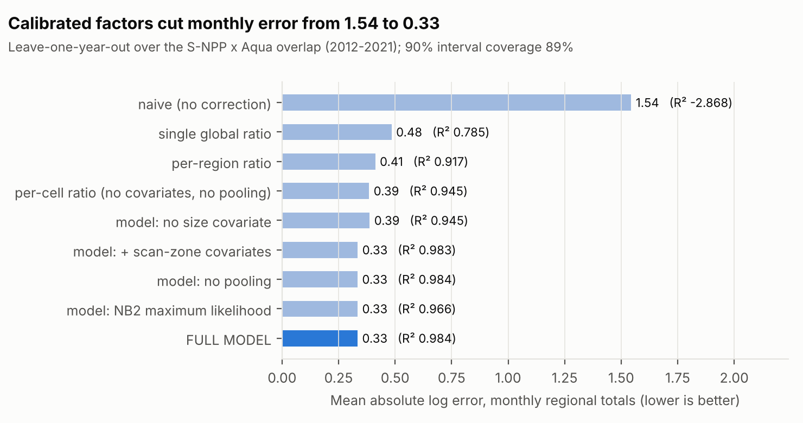
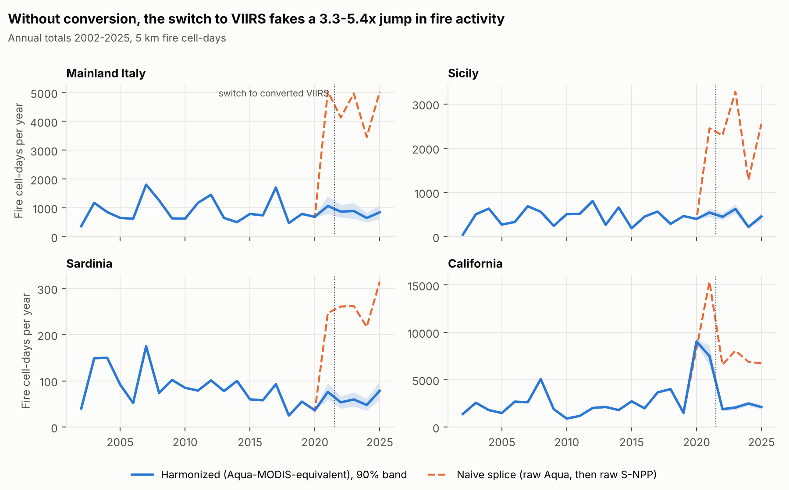
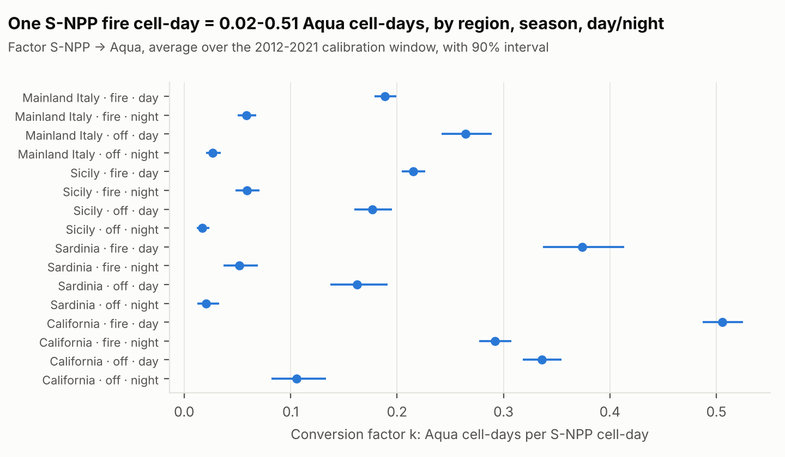
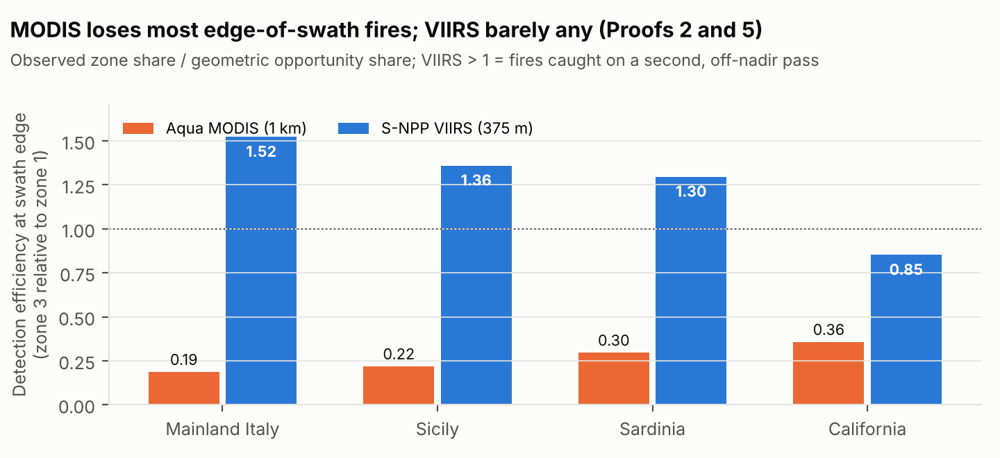
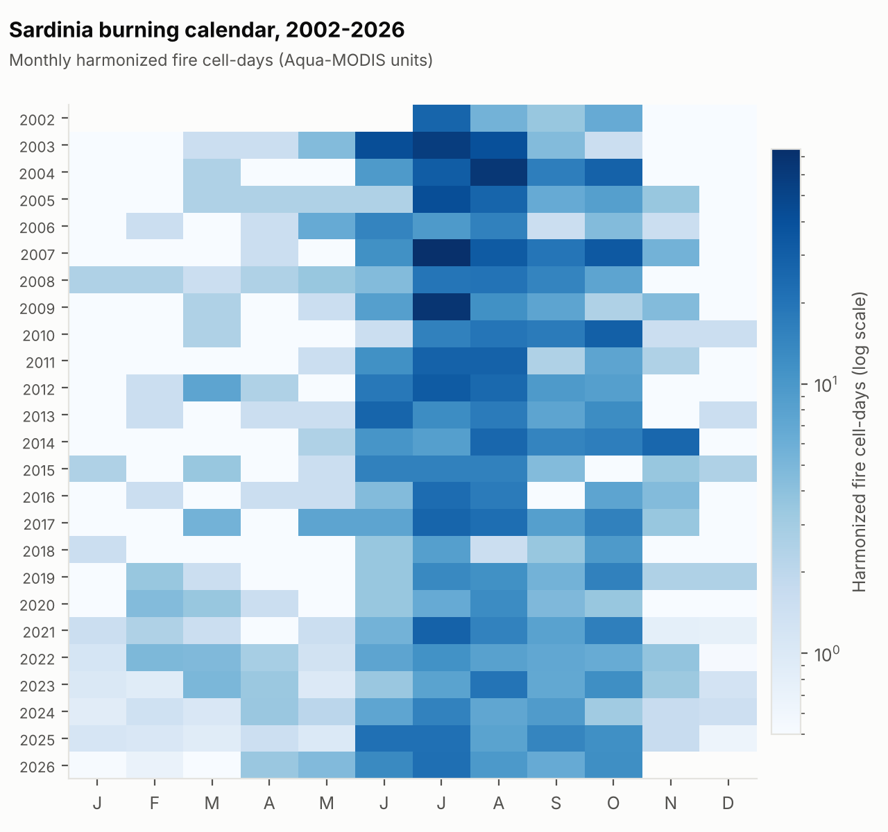
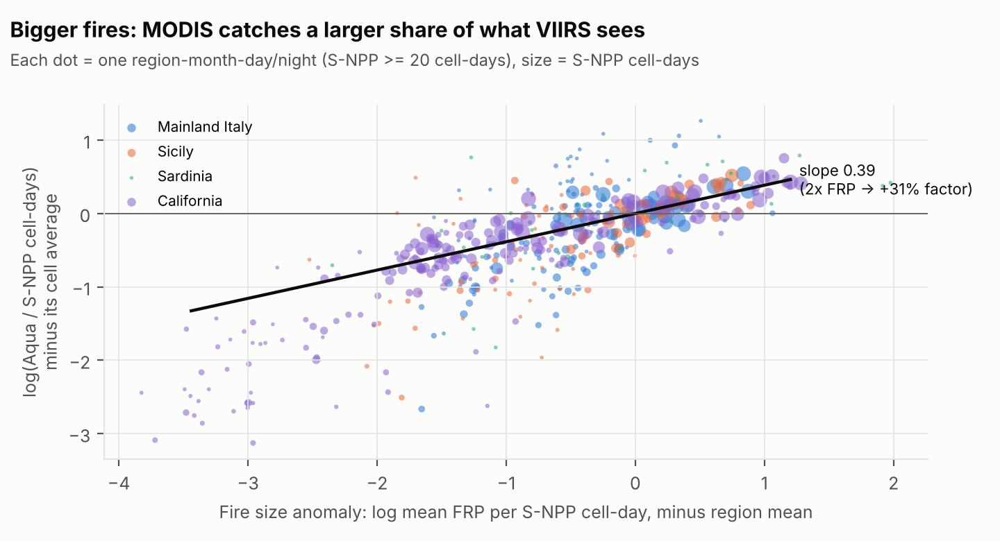

# Results

## 1. Conversion factors (typical scan geometry)

| model                | region         | season   | daynight   |   sum_ref |   sum_src |   factor |   factor_lo90 |   factor_hi90 |
|:---------------------|:---------------|:---------|:-----------|----------:|----------:|---------:|--------------:|--------------:|
| SNPP->AQUA           | italy_mainland | fire     | D          |      4714 |     25092 |    0.189 |         0.179 |         0.199 |
| SNPP->AQUA           | italy_mainland | fire     | N          |       642 |     11008 |    0.059 |         0.05  |         0.068 |
| SNPP->AQUA           | italy_mainland | off      | D          |      2526 |      9460 |    0.264 |         0.242 |         0.289 |
| SNPP->AQUA           | italy_mainland | off      | N          |        83 |      3108 |    0.027 |         0.02  |         0.034 |
| SNPP->AQUA           | sicily         | fire     | D          |      3242 |     15087 |    0.215 |         0.205 |         0.226 |
| SNPP->AQUA           | sicily         | fire     | N          |       263 |      4453 |    0.059 |         0.048 |         0.071 |
| SNPP->AQUA           | sicily         | off      | D          |       598 |      3432 |    0.177 |         0.16  |         0.195 |
| SNPP->AQUA           | sicily         | off      | N          |        11 |       760 |    0.017 |         0.012 |         0.024 |
| SNPP->AQUA           | sardinia       | fire     | D          |       416 |      1089 |    0.374 |         0.337 |         0.413 |
| SNPP->AQUA           | sardinia       | fire     | N          |        18 |       365 |    0.052 |         0.037 |         0.069 |
| SNPP->AQUA           | sardinia       | off      | D          |       174 |      1082 |    0.163 |         0.137 |         0.191 |
| SNPP->AQUA           | sardinia       | off      | N          |         7 |       206 |    0.021 |         0.012 |         0.033 |
| SNPP->AQUA           | california     | fire     | D          |     10535 |     20836 |    0.506 |         0.487 |         0.525 |
| SNPP->AQUA           | california     | fire     | N          |      6749 |     23109 |    0.292 |         0.277 |         0.307 |
| SNPP->AQUA           | california     | off      | D          |      9918 |     29547 |    0.336 |         0.318 |         0.355 |
| SNPP->AQUA           | california     | off      | N          |      1144 |     11004 |    0.106 |         0.082 |         0.133 |
| NOAA20->SNPP         | italy_mainland | fire     | D          |     21736 |     22145 |    0.98  |         0.968 |         0.992 |
| NOAA20->SNPP         | italy_mainland | fire     | N          |      8759 |      9292 |    0.95  |         0.931 |         0.967 |
| NOAA20->SNPP         | italy_mainland | off      | D          |      8233 |      9126 |    0.917 |         0.89  |         0.944 |
| NOAA20->SNPP         | italy_mainland | off      | N          |      2309 |      2538 |    0.919 |         0.889 |         0.948 |
| NOAA20->SNPP         | sicily         | fire     | D          |     12549 |     12927 |    0.974 |         0.959 |         0.987 |
| NOAA20->SNPP         | sicily         | fire     | N          |      4353 |      4496 |    0.961 |         0.942 |         0.981 |
| NOAA20->SNPP         | sicily         | off      | D          |      3515 |      3771 |    0.923 |         0.897 |         0.95  |
| NOAA20->SNPP         | sicily         | off      | N          |       816 |       860 |    0.919 |         0.883 |         0.958 |
| NOAA20->SNPP         | sardinia       | fire     | D          |       879 |       890 |    0.979 |         0.952 |         1.009 |
| NOAA20->SNPP         | sardinia       | fire     | N          |       278 |       281 |    0.951 |         0.921 |         0.985 |
| NOAA20->SNPP         | sardinia       | off      | D          |       801 |       836 |    0.915 |         0.883 |         0.952 |
| NOAA20->SNPP         | sardinia       | off      | N          |       168 |       170 |    0.904 |         0.865 |         0.945 |
| NOAA20->SNPP         | california     | fire     | D          |     22676 |     22498 |    1.008 |         0.994 |         1.021 |
| NOAA20->SNPP         | california     | fire     | N          |     24801 |     25316 |    0.98  |         0.97  |         0.989 |
| NOAA20->SNPP         | california     | off      | D          |     29548 |     30111 |    0.981 |         0.97  |         0.993 |
| NOAA20->SNPP         | california     | off      | N          |     10949 |     11595 |    0.944 |         0.929 |         0.959 |
| NOAA20->AQUA (chain) | italy_mainland | fire     | D          |       nan |       nan |    0.185 |         0.175 |         0.196 |
| NOAA20->AQUA (chain) | italy_mainland | fire     | N          |       nan |       nan |    0.056 |         0.048 |         0.065 |
| NOAA20->AQUA (chain) | italy_mainland | off      | D          |       nan |       nan |    0.242 |         0.221 |         0.266 |
| NOAA20->AQUA (chain) | italy_mainland | off      | N          |       nan |       nan |    0.025 |         0.019 |         0.032 |
| NOAA20->AQUA (chain) | sicily         | fire     | D          |       nan |       nan |    0.21  |         0.199 |         0.221 |
| NOAA20->AQUA (chain) | sicily         | fire     | N          |       nan |       nan |    0.056 |         0.047 |         0.069 |
| NOAA20->AQUA (chain) | sicily         | off      | D          |       nan |       nan |    0.163 |         0.147 |         0.181 |
| NOAA20->AQUA (chain) | sicily         | off      | N          |       nan |       nan |    0.016 |         0.011 |         0.023 |
| NOAA20->AQUA (chain) | sardinia       | fire     | D          |       nan |       nan |    0.366 |         0.329 |         0.407 |
| NOAA20->AQUA (chain) | sardinia       | fire     | N          |       nan |       nan |    0.049 |         0.036 |         0.067 |
| NOAA20->AQUA (chain) | sardinia       | off      | D          |       nan |       nan |    0.149 |         0.126 |         0.176 |
| NOAA20->AQUA (chain) | sardinia       | off      | N          |       nan |       nan |    0.019 |         0.011 |         0.03  |
| NOAA20->AQUA (chain) | california     | fire     | D          |       nan |       nan |    0.51  |         0.49  |         0.53  |
| NOAA20->AQUA (chain) | california     | fire     | N          |       nan |       nan |    0.286 |         0.272 |         0.301 |
| NOAA20->AQUA (chain) | california     | off      | D          |       nan |       nan |    0.33  |         0.312 |         0.349 |
| NOAA20->AQUA (chain) | california     | off      | N          |       nan |       nan |    0.1   |         0.078 |         0.127 |

## 2. Model diagnostics

| fit                 |   alpha |   pearson_dispersion |   elasticity_b |   elasticity_se |   elasticity_p |   zone_wald_p |   trend_pct_per_decade |   trend_p |    DL_Q |   DL_df |
|:--------------------|--------:|---------------------:|---------------:|----------------:|---------------:|--------------:|-----------------------:|----------:|--------:|--------:|
| fit1_SNPP_to_AQUA   |  0.0948 |               1.7749 |         1.0355 |          0.0213 |         0.0951 |        0.5195 |                -5.7034 |    0.1665 | 128.215 |       8 |
| fit2_NOAA20_to_SNPP |  0.0019 |               1.3528 |         0.9943 |          0.0049 |         0.2479 |        0.0553 |                -0.3105 |    0.8205 |   6.493 |       8 |

## 3. Leave-one-year-out (monthly regional totals, out of sample)

| method                                     |   n |     MAE |    RMSE |    bias |     R2 |   MALE |   coverage90 |
|:-------------------------------------------|----:|--------:|--------:|--------:|-------:|-------:|-------------:|
| naive (no correction)                      | 456 | 260.088 | 488.64  | 260.083 | -2.868 |  1.545 |      nan     |
| single global ratio                        | 456 |  35.322 | 115.241 |  -0.449 |  0.785 |  0.485 |      nan     |
| per-region ratio                           | 456 |  22.143 |  71.698 |  -0.646 |  0.917 |  0.412 |      nan     |
| per-cell ratio (no covariates, no pooling) | 456 |  21.396 |  58.497 |  -0.754 |  0.945 |  0.385 |      nan     |
| model: no size covariate                   | 456 |  21.458 |  58.336 |  -0.511 |  0.945 |  0.388 |      nan     |
| model: + scan-zone covariates              | 456 |  13.616 |  32.018 |   0.499 |  0.983 |  0.335 |      nan     |
| model: no pooling                          | 456 |  13.59  |  31.643 |   0.364 |  0.984 |  0.334 |      nan     |
| model: NB2 maximum likelihood              | 456 |  16.341 |  45.93  |   3.478 |  0.966 |  0.334 |      nan     |
| FULL MODEL                                 | 456 |  13.569 |  31.514 |   0.365 |  0.984 |  0.334 |        0.888 |

Full model by region:

| region         |   n |    MAE |   RMSE |   bias |    R2 |   MALE |   coverage90 |
|:---------------|----:|-------:|-------:|-------:|------:|-------:|-------------:|
| italy_mainland | 114 | 15.049 | 23.624 | -0.307 | 0.938 |  0.391 |        0.868 |
| sicily         | 114 |  6.851 | 12.762 | -0.054 | 0.945 |  0.398 |        0.86  |
| sardinia       | 114 |  1.86  |  2.719 | -0.09  | 0.863 |  0.394 |        0.912 |
| california     | 114 | 30.515 | 56.957 |  1.909 | 0.984 |  0.154 |        0.912 |
| ALL            | 456 | 13.569 | 31.514 |  0.365 | 0.984 |  0.334 |        0.888 |

## 4. Leave-one-region-out

| held_out       | method                       |   n |     MAE |    RMSE |     bias |     R2 |   MALE |   coverage90 |
|:---------------|:-----------------------------|----:|--------:|--------:|---------:|-------:|-------:|-------------:|
| italy_mainland | FULL MODEL (population mean) | 114 |  90.455 | 161.456 |   87.744 | -1.904 |  0.684 |        0.974 |
| italy_mainland | single global ratio          | 114 |  59.739 |  96.304 |   57.37  | -0.033 |  0.588 |      nan     |
| sicily         | FULL MODEL (population mean) | 114 |  35.155 |  54.182 |   34.699 |  0.006 |  0.807 |        0.956 |
| sicily         | single global ratio          | 114 |  20.842 |  30.838 |   20.473 |  0.678 |  0.686 |      nan     |
| sardinia       | FULL MODEL (population mean) | 114 |   3.25  |   5.565 |    2.432 |  0.427 |  0.535 |        0.982 |
| sardinia       | single global ratio          | 114 |   2.865 |   4.326 |    0.803 |  0.654 |  0.538 |      nan     |
| california     | FULL MODEL (population mean) | 114 | 128.579 | 250.041 | -128.579 |  0.686 |  0.762 |        0.237 |
| california     | single global ratio          | 114 | 124.631 | 308.985 | -123.447 |  0.521 |  0.471 |      nan     |

## 5. Seam tests (no step where the source switches)

| seam           | region         |   months |   log_ratio |   step_pct |   lo90_pct |   hi90_pct | no_step   | split   | kind                 |
|:---------------|:---------------|---------:|------------:|-----------:|-----------:|-----------:|:----------|:--------|:---------------------|
| S-NPP->Aqua    | italy_mainland |       24 |       -0.06 |      -5.97 |     -16.2  |       7.82 | True      | 2014-07 | placebo              |
| S-NPP->Aqua    | sicily         |       24 |       -0.07 |      -6.34 |     -19.23 |       7.38 | True      | 2014-07 | placebo              |
| S-NPP->Aqua    | sardinia       |       24 |        0.07 |       7.73 |     -13.23 |      32.67 | True      | 2014-07 | placebo              |
| S-NPP->Aqua    | california     |       24 |        0.01 |       1.12 |      -6.76 |       8.49 | True      | 2014-07 | placebo              |
| S-NPP->Aqua    | ALL            |       96 |       -0.01 |      -1.17 |      -7.01 |       4.88 | True      | 2014-07 | placebo              |
| S-NPP->Aqua    | italy_mainland |       24 |       -0.07 |      -6.47 |     -15.38 |       3.86 | True      | 2015-07 | placebo              |
| S-NPP->Aqua    | sicily         |       24 |       -0.15 |     -13.88 |     -23.94 |      -3.32 | False     | 2015-07 | placebo              |
| S-NPP->Aqua    | sardinia       |       24 |       -0.11 |     -10.84 |     -27.13 |       7.41 | True      | 2015-07 | placebo              |
| S-NPP->Aqua    | california     |       24 |        0.03 |       2.66 |      -5.14 |       9.34 | True      | 2015-07 | placebo              |
| S-NPP->Aqua    | ALL            |       96 |       -0.02 |      -1.7  |      -7.59 |       3.88 | True      | 2015-07 | placebo              |
| S-NPP->Aqua    | italy_mainland |       24 |        0.02 |       2.22 |     -10.22 |      14.12 | True      | 2016-07 | placebo              |
| S-NPP->Aqua    | sicily         |       24 |       -0.01 |      -0.64 |     -11.67 |       9.37 | True      | 2016-07 | placebo              |
| S-NPP->Aqua    | sardinia       |       24 |       -0.06 |      -5.64 |     -22.55 |      15.62 | True      | 2016-07 | placebo              |
| S-NPP->Aqua    | california     |       24 |       -0    |      -0.12 |      -7.71 |       7.07 | True      | 2016-07 | placebo              |
| S-NPP->Aqua    | ALL            |       96 |        0    |       0.33 |      -5.8  |       6.27 | True      | 2016-07 | placebo              |
| S-NPP->Aqua    | italy_mainland |       24 |        0.09 |       9.41 |      -2.37 |      21.44 | True      | 2017-07 | placebo              |
| S-NPP->Aqua    | sicily         |       24 |        0.06 |       6.44 |      -4.53 |      15.81 | True      | 2017-07 | placebo              |
| S-NPP->Aqua    | sardinia       |       24 |        0    |       0.21 |     -22.78 |      36.06 | True      | 2017-07 | placebo              |
| S-NPP->Aqua    | california     |       24 |        0.03 |       3.23 |      -5.48 |      10.67 | True      | 2017-07 | placebo              |
| S-NPP->Aqua    | ALL            |       96 |        0.05 |       4.63 |      -2.28 |      10.57 | True      | 2017-07 | placebo              |
| S-NPP->Aqua    | italy_mainland |       24 |       -0.05 |      -5.02 |     -14.91 |       5.22 | True      | 2018-07 | placebo              |
| S-NPP->Aqua    | sicily         |       24 |        0.01 |       1.05 |      -8.56 |      11.23 | True      | 2018-07 | placebo              |
| S-NPP->Aqua    | sardinia       |       24 |        0.13 |      13.36 |     -12.51 |      47.81 | True      | 2018-07 | placebo              |
| S-NPP->Aqua    | california     |       24 |        0.05 |       5.42 |      -3.57 |      12.2  | True      | 2018-07 | placebo              |
| S-NPP->Aqua    | ALL            |       96 |        0.03 |       3.16 |      -3.58 |       8.87 | True      | 2018-07 | placebo              |
| S-NPP->Aqua    | italy_mainland |       24 |       -0.11 |     -10.3  |     -20.06 |       0.07 | True      | 2019-07 | real seam (Jul 2021) |
| S-NPP->Aqua    | sicily         |       24 |       -0.11 |     -10.56 |     -19.7  |      -1.61 | False     | 2019-07 | real seam (Jul 2021) |
| S-NPP->Aqua    | sardinia       |       24 |        0.05 |       4.72 |     -14.44 |      28.8  | True      | 2019-07 | real seam (Jul 2021) |
| S-NPP->Aqua    | california     |       24 |       -0.04 |      -3.57 |      -8.9  |       6.72 | True      | 2019-07 | real seam (Jul 2021) |
| S-NPP->Aqua    | ALL            |       96 |       -0.05 |      -4.83 |      -9.22 |       1.74 | True      | 2019-07 | real seam (Jul 2021) |
| NOAA-20->S-NPP | italy_mainland |       24 |       -0    |      -0.43 |      -4.01 |       2.45 | True      | 2020-11 | placebo              |
| NOAA-20->S-NPP | sicily         |       24 |        0.01 |       0.77 |      -2.58 |       4.38 | True      | 2020-11 | placebo              |
| NOAA-20->S-NPP | sardinia       |       24 |        0.1  |      10.23 |       1.62 |      23.36 | False     | 2020-11 | placebo              |
| NOAA-20->S-NPP | california     |       24 |       -0    |      -0.01 |      -1.36 |       1.33 | True      | 2020-11 | placebo              |
| NOAA-20->S-NPP | ALL            |       96 |        0    |       0.11 |      -1.15 |       1.34 | True      | 2020-11 | placebo              |
| NOAA-20->S-NPP | italy_mainland |       24 |       -0.03 |      -2.92 |      -7.14 |       0.35 | True      | 2021-11 | placebo              |
| NOAA-20->S-NPP | sicily         |       24 |       -0    |      -0.1  |      -2.81 |       2.27 | True      | 2021-11 | placebo              |
| NOAA-20->S-NPP | sardinia       |       24 |        0.04 |       4.21 |      -5    |      14.96 | True      | 2021-11 | placebo              |
| NOAA-20->S-NPP | california     |       24 |        0.01 |       0.65 |      -1.24 |       2.61 | True      | 2021-11 | placebo              |
| NOAA-20->S-NPP | ALL            |       96 |       -0.01 |      -0.54 |      -2.14 |       1.02 | True      | 2021-11 | placebo              |
| NOAA-20->S-NPP | italy_mainland |       24 |       -0.01 |      -0.96 |      -5.74 |       2.91 | True      | 2022-11 | placebo              |
| NOAA-20->S-NPP | sicily         |       24 |        0.01 |       1.35 |      -1.85 |       4.79 | True      | 2022-11 | placebo              |
| NOAA-20->S-NPP | sardinia       |       24 |        0.03 |       3.32 |      -6.19 |      12.36 | True      | 2022-11 | placebo              |
| NOAA-20->S-NPP | california     |       24 |        0.01 |       1.1  |      -1.15 |       3.56 | True      | 2022-11 | placebo              |
| NOAA-20->S-NPP | ALL            |       96 |        0.01 |       0.56 |      -1.3  |       2.38 | True      | 2022-11 | placebo              |
| NOAA-20->S-NPP | italy_mainland |       24 |       -0.01 |      -1.24 |      -4.46 |       1.43 | True      | 2023-11 | placebo              |
| NOAA-20->S-NPP | sicily         |       24 |       -0    |      -0.38 |      -3.08 |       3    | True      | 2023-11 | placebo              |
| NOAA-20->S-NPP | sardinia       |       24 |        0.06 |       6.23 |      -1.06 |      14.05 | True      | 2023-11 | placebo              |
| NOAA-20->S-NPP | california     |       24 |        0.01 |       0.54 |      -1.94 |       3.29 | True      | 2023-11 | placebo              |
| NOAA-20->S-NPP | ALL            |       96 |       -0    |      -0.06 |      -1.7  |       1.68 | True      | 2023-11 | placebo              |
| NOAA-20->S-NPP | italy_mainland |       23 |       -0    |      -0.26 |      -2.49 |       1.71 | True      | 2024-11 | real seam (Nov 2026) |
| NOAA-20->S-NPP | sicily         |       23 |       -0.03 |      -3.41 |      -6.66 |      -0.66 | False     | 2024-11 | real seam (Nov 2026) |
| NOAA-20->S-NPP | sardinia       |       23 |        0.03 |       2.88 |      -5.91 |      12.33 | True      | 2024-11 | real seam (Nov 2026) |
| NOAA-20->S-NPP | california     |       23 |       -0    |      -0.16 |      -2.42 |       2.33 | True      | 2024-11 | real seam (Nov 2026) |
| NOAA-20->S-NPP | ALL            |       92 |       -0.01 |      -0.72 |      -2.17 |       0.76 | True      | 2024-11 | real seam (Nov 2026) |

## 6. Chain stress test (NOAA-20 alone vs S-NPP route, 2021-07..2026-10)

| region         |   months |   total_ratio_chain_over_snpp |   MALE |    R2 |
|:---------------|---------:|------------------------------:|-------:|------:|
| california     |       64 |                         1.003 |  0.059 | 0.999 |
| italy_mainland |       64 |                         0.996 |  0.138 | 0.99  |
| sardinia       |       64 |                         0.991 |  0.193 | 0.838 |
| sicily         |       64 |                         0.994 |  0.127 | 0.993 |
| ALL            |      256 |                         1     |  0.129 | 0.999 |

## 7. Known extreme years

| region   |   year |   annual_rank |   of_years |   july_percentile |   july_robust_z |
|:---------|-------:|--------------:|-----------:|------------------:|----------------:|
| sardinia |   2021 |            13 |         23 |             68.18 |            0.8  |
| sicily   |   2023 |             5 |         23 |             81.82 |            1.48 |

## 8. Edge-of-swath detection efficiency (physics check of Proofs 2 and 5)

| satellite   | region         |    w1 |    w2 |    w3 |   pi1 |   pi2 |   pi3 |   eff_z2 |   eff_z3 |
|:------------|:---------------|------:|------:|------:|------:|------:|------:|---------:|---------:|
| AQUA        | italy_mainland | 0.751 | 0.163 | 0.086 | 0.437 | 0.294 | 0.269 |    0.323 |    0.186 |
| AQUA        | sicily         | 0.674 | 0.21  | 0.116 | 0.406 | 0.273 | 0.321 |    0.464 |    0.218 |
| AQUA        | sardinia       | 0.686 | 0.171 | 0.143 | 0.421 | 0.283 | 0.297 |    0.37  |    0.296 |
| AQUA        | california     | 0.583 | 0.249 | 0.168 | 0.403 | 0.271 | 0.325 |    0.635 |    0.357 |
| SNPP        | italy_mainland | 0.513 | 0.252 | 0.235 | 0.503 | 0.345 | 0.151 |    0.717 |    1.523 |
| SNPP        | sicily         | 0.452 | 0.27  | 0.278 | 0.468 | 0.321 | 0.211 |    0.87  |    1.36  |
| SNPP        | sardinia       | 0.508 | 0.243 | 0.249 | 0.484 | 0.332 | 0.183 |    0.697 |    1.296 |
| SNPP        | california     | 0.514 | 0.283 | 0.204 | 0.465 | 0.319 | 0.216 |    0.802 |    0.852 |

## 9. Aqua orbit drift: drifted Aqua / harmonized, by year

|   year |   california |   italy_mainland |   sardinia |   sicily |
|-------:|-------------:|-----------------:|-----------:|---------:|
|   2021 |        0.987 |            1.084 |      0.963 |    1.262 |
|   2022 |        0.925 |            0.957 |      0.871 |    1.001 |
|   2023 |        1.003 |            0.885 |      0.973 |    1.118 |
|   2024 |        0.851 |            1.006 |      1.358 |    0.881 |
|   2025 |        0.844 |            1.003 |      0.946 |    1.221 |
|   2026 |        0.739 |            1.043 |      1.351 |    1.227 |

## Figures

